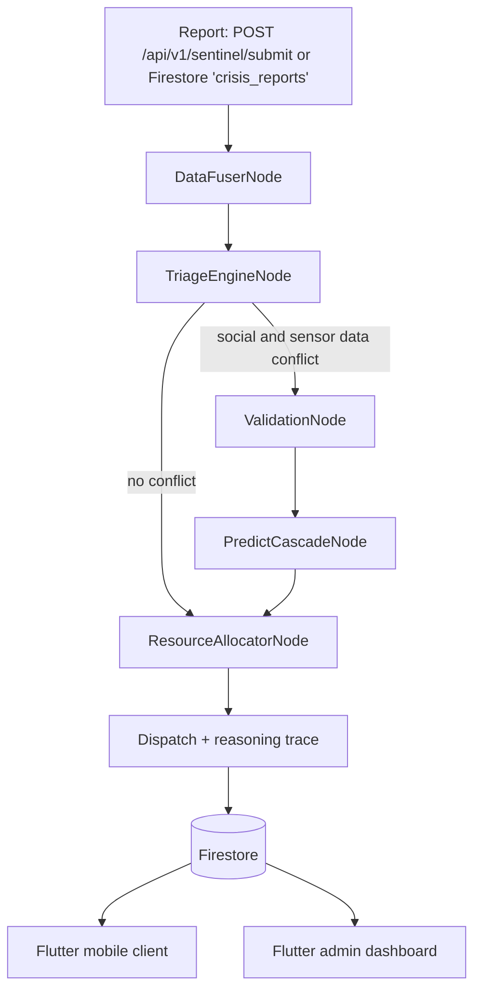

# Aegis-AI: Omni-Crisis Intelligence Swarm

> A LangGraph multi-agent backend that triages urban-crisis reports with Llama-3-70B and picks a response dispatch, with Flutter citizen and admin clients on Firebase — built to cut the time dispatchers spend cross-checking conflicting reports.

**Status:** Prototype · Karachi-focused demo scenario · 15 commits, May–Aug 2026 · runs in mock mode without an LLM key
**Demo:** [Screen recording in this repo (83 MB)](https://github.com/HamzaKhanBUIC/Aegis-AI-The-Omni_Crisis-Intelligence-Swarm/raw/main/Antigravity_prompts_usage.mp4) · no live deployment

---

## Architecture & Workflow

The backend (`src/main_api.py`, FastAPI) receives reports over REST or from a Firestore listener on `crisis_reports` and runs them through a compiled LangGraph (`src/agents/graph.py`).



The demo scenario in `demo/` (written up in `demo/demo_summary.md`) feeds flood reports alongside a weather sensor reading 0.0 mm of rain; the validation node reclassifies the incident as a burst water main.

## Key Features

- **Staged agent graph:** five nodes — data fuser, triage, validation, cascade prediction, resource allocator (`src/agents/graph.py`).
- **LLM triage:** `meta-llama/Meta-Llama-3-70B-Instruct` through the Hugging Face `InferenceClient` (`src/agents/swarms/triage_agent.py`).
- **Deterministic fallback:** with `USE_LIVE_AI=False`, no token, or an LLM failure, triage uses a rule-based classification and a circuit-breaker response.
- **Input guard:** a phrase denylist sanitizes incoming text (`src/security/guardrails.py`).
- **Reasoning trace:** each run returns the step-by-step trace; the API also appends to a text log.
- **Clients:** Flutter mobile and admin apps under `Aegis-Omni-Master/`, using Firestore, Firebase Auth and `flutter_map`.

## Quickstart & Installation

### Prerequisites
- Python 3.10 or newer (`pyproject.toml`; CI and the Dockerfile use 3.11)
- [Poetry](https://python-poetry.org/)
- Flutter SDK, only for the clients
- A Firebase service-account JSON, for the API server

### Setup
```bash
git clone https://github.com/HamzaKhanBUIC/Aegis-AI-The-Omni_Crisis-Intelligence-Swarm.git
cd Aegis-AI-The-Omni_Crisis-Intelligence-Swarm
poetry install
cp .env.example .env     # set USE_LIVE_AI="False" to run in mock mode
poetry run python src/main_api.py   # serves on 0.0.0.0:8000
```
`deploy/docker-compose.yml` is also provided; its header lists the files it expects.

`poetry install` timed out on PyPI in the audit environment, so the locked set was installed another way. The main API server was not started for this pass.

## Configuration & Environment

From `.env.example` and the code:

| Variable | Default | Description |
| :--- | :--- | :--- |
| `HF_API_TOKEN` | empty | Hugging Face token for Llama-3-70B |
| `USE_LIVE_AI` | `False` in the agents, `True` in `src/core/` | `True` calls the LLM; `False` uses mock/rule-based output |
| `FIREBASE_CREDENTIALS_PATH` | `config/serviceAccountKey.json` | Firebase Admin credentials (never commit this file) |

## Testing & Verification

```bash
poetry run ruff check src/
poetry run pytest tests/ -v
```
Both pass, but the two tests (`tests/unit/test_core.py`, `tests/integration/test_integration.py`) are print-only: they contain no assertions. One swallows a `TypeError` (`remediation_agent.py:25`, `cascading_threats` defaults to `None`) and still reports a pass. Treat them as smoke runs, not verification.

## Architectural Decisions & Trade-offs

- **LangGraph over ad-hoc calls:** the conditional edge after triage routes conflicting signals to validation, which keeps that branch explicit and testable.
- **Mock mode first:** the swarm runs with no key, so the graph can be demonstrated without paid inference.
- **Firestore as the client bus:** clients write reports and read dispatches directly, at the cost of the security issues below.

## Limitations & Roadmap

- **Firestore rules are open on `main`** (`Aegis-Omni-Master/firestore.rules`: `allow read, write: if true`). Anyone can read and write the database. [Open PR #13](https://github.com/HamzaKhanBUIC/Aegis-AI-The-Omni_Crisis-Intelligence-Swarm/pull/13) tightens them but they must also be deployed.
- **The submit endpoint has no authentication or rate limit on `main`**, and CORS allows all origins with credentials; each report can trigger a paid LLM call. Also addressed in PR #13.
- **Allocation is hard-coded.** The resource allocator is an `if` on the crisis type that returns fixed Karachi agencies. There is no pathfinding or route optimization.
- **Placeholder modules:** `src/security/zero_trust_policy.py`, `src/tools/cyber_scanners.py` and `src/tools/patch_generator.py` are stubs and are not imported.
- **Not implemented:** an offline or peer-to-peer mobile client, local Ollama support, and persisted LangGraph checkpoints.
- **Dependencies:** the locked set had 65 advisories at audit time.
- **Repo contents:** the tree includes an 83 MB video, a trace log, `requirements_old.txt` and a nested duplicate `frontend_admin/frontend_admin/` directory.
- **Not verified:** the Flutter apps were not built, and a live-LLM run was not made.

## License

MIT. See [LICENSE](LICENSE).
